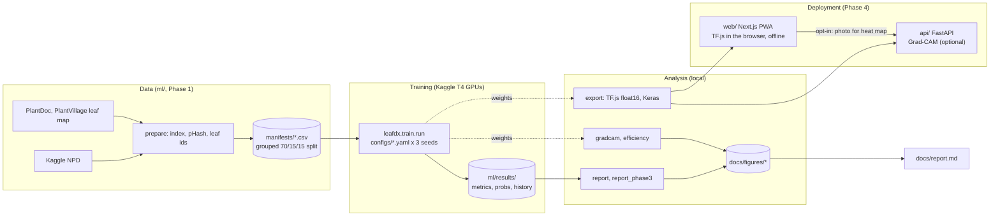

# Plant leaf disease detection: leakage, field shift and an offline app

A research project that reproduces and extends *Plant Leaf Disease Detection Using Traditional
CNN and MobileNet Architecture* (Usman & Ali; [`docs/paper.pdf`](docs/paper.pdf)). It audits
the dataset for leakage, reproduces the paper, retrains five architectures on a leak-free
split, tests them on field photos, explains and compresses them, and serves the selected model
in a progressive web app that classifies photos in the browser.

**Read first:** [the report](docs/report.md) (paper format), the [model card](docs/model_card.md)
and the [dataset card](docs/dataset_card.md).

## Findings

Every number is generated by a script from the run outputs in `ml/results/`; mean ± std over
three seeds.

1. **The standard NPD split leaks.** 90.3% of its validation images are augmented copies of,
   or other photos of the same leaf as, training images.
2. **Lab accuracy is high on a leak-free split**: 98.26 ± 0.43% for MobileNetV1 and
   99.18 ± 0.07% for EfficientNetB0 on leak-free test images (88.46% for the paper's CNN).
3. **Field accuracy is not.** On 2,557 PlantDoc field photos every model scores 7–18%, a drop
   of 81–85 pp, and wrong answers come with 73–77% average confidence.
4. **The paper's choices, tested**: its augmentation does not help (lab +1.0 pp without it,
   field unchanged); its frozen backbone costs 4.7 pp.
5. **Deployment**: MobileNetV1 in full INT8 is 3.55 MB and 1.4 ms on a laptop CPU at −0.54 pp;
   full INT8 breaks EfficientNetB0 (−29.8 pp) and MobileNetV3-Small (−38.1 pp).

| Model | Params (M) | Lab test, leak-free (%) | PlantDoc field (%) |
|---|---|---|---|
| Paper CNN (softmax) | 2.43 | 88.46 ± 0.38 | 7.46 ± 1.02 |
| MobileNetV1 (deployed) | 3.27 | 98.26 ± 0.43 | 16.33 ± 1.12 |
| MobileNetV2 | 2.31 | 97.47 ± 0.43 | 15.02 ± 1.98 |
| MobileNetV3-Small | 0.96 | 98.45 ± 0.18 | 13.84 ± 1.22 |
| EfficientNetB0 | 4.10 | 99.18 ± 0.07 | 18.15 ± 0.58 |

## Architecture



Photos never leave the phone unless the user asks for a heat map, which sends that one photo
to the API.

## Repository layout

```
ml/        Python package `leafdx` (TensorFlow/Keras): data pipeline, training, evaluation,
           Grad-CAM, efficiency, export. configs/, manifests/ (CSV + SHA256SUMS), results/,
           notebooks/ (EDA, Kaggle training)
web/       Next.js 16 PWA: detect, result, disease library, research and about pages
api/       FastAPI service: /predict with optional Grad-CAM overlay
docs/      report, model and dataset cards, reproduction notes, experiments, deployment,
           references.bib, figures/ (all generated by scripts)
```

## Reproducing

Requirements: Python 3.12 (TensorFlow does not support 3.13+ here; on Apple silicon use a
native arm64 build), Node 20+, a free Kaggle account. Training needs a GPU; the notebooks run on
Kaggle's free T4s.

### 1. Data and audit

```bash
cd ml
make setup PYTHON=python3.12   # venv + editable install
# Kaggle token: kaggle.com -> Settings -> API -> Create New Token; save it to
# ~/.kaggle/access_token (never commit or paste it)
make data                      # NPD (Kaggle), PlantDoc and the PlantVillage leaf map (GitHub)
make prepare                   # index, audit, split -> manifests/, docs/figures/data_audit/
(cd manifests && shasum -a 256 -c SHA256SUMS)   # same split as ours?
make eda                       # docs/figures/eda/
```

### 2. Reproduction of the paper (Phase 2)

```bash
.venv/bin/python -m leafdx.train.run --config configs/paper/mobilenet_fullepochs.yaml
.venv/bin/python -m leafdx.train.run --config configs/paper/cnn_fullepochs.yaml
make report                    # docs/figures/reproduction/
```

The full-epoch runs need a GPU; `notebooks/kaggle_train.ipynb` runs them on Kaggle. Assumptions
and results: [`docs/reproduction.md`](docs/reproduction.md).

### 3. Corrected and extended experiments (Phase 3)

Train the 27 runs (9 configs × seeds 42, 43, 44) on Kaggle with
`ml/notebooks/kaggle_phase3.ipynb` (generated by `notebooks/build_kaggle_phase3.py`), or one run
locally:

```bash
.venv/bin/python -m leafdx.train.run --config configs/phase3/mobilenet_v1.yaml --set seed=43
```

Unzip the notebook's outputs into `ml/results/` (metrics) and `ml/models/` (weights), then:

```bash
.venv/bin/python -m leafdx.train.report_phase3 --results results --out ../docs/figures/phase3
.venv/bin/python -m leafdx.explain.gradcam --models models --per-class 5
.venv/bin/python -m leafdx.train.efficiency --models models   # TF.js part uses .venv-tfjs
```

Write-up: [`docs/experiments.md`](docs/experiments.md).

### 4. Export to the app

```bash
.venv/bin/python -m leafdx.train.export_web classes     # web/src/data/classes.json
.venv/bin/python -m leafdx.train.export_web research    # web/src/data/research.json
.venv/bin/python -m leafdx.train.export_web api-model   # api/model/
# TF.js model (float16 weights), from the SavedModel written by the efficiency study:
E=models/_export/p3_mobilenet_v1
.venv-tfjs/bin/tensorflowjs_converter --input_format=tf_saved_model \
  --output_format=tfjs_graph_model --signature_name=serving_default \
  --quantize_float16='*' $E/saved_model $E/tfjs_fp16
rm -rf ../web/public/model && cp -R $E/tfjs_fp16 ../web/public/model
.venv/bin/python -m leafdx.train.export_web verify && (cd ../web && npm run verify-model)
```

`.venv-tfjs` is a separate environment: `python3.12 -m venv .venv-tfjs &&
.venv-tfjs/bin/pip install -r requirements-tfjs.txt`.

### 5. Run the app

```bash
cd web && npm install && npm run dev            # http://localhost:3000
# optional heat maps:
cd api && python3.12 -m venv .venv && .venv/bin/pip install -e ".[dev]"
.venv/bin/uvicorn leafdx_api.main:app --port 8000
cd web && NEXT_PUBLIC_API_URL=http://localhost:8000 npm run dev
```

Or with Docker: `docker compose up --build`. Deployment (free on Vercel):
[`docs/deployment.md`](docs/deployment.md).

### Tests and lint

```bash
(cd ml && make test lint)
(cd api && .venv/bin/pytest -q && .venv/bin/ruff check . && .venv/bin/ruff format --check .)
(cd web && npm run lint && npm run typecheck && npm test && npm run build && npm run e2e)
```

CI runs all of these, plus the Docker builds, on every push (`.github/workflows/ci.yml`).

## Data and licences

The repository contains no dataset images except small sample grids and example figures in
`docs/figures/`, with attribution. NPD and PlantVillage: CC BY-SA 3.0 (upstream terms);
PlantDoc: CC BY 4.0. Details in the [dataset card](docs/dataset_card.md#1-datasets-used).

A licence for the code has not been chosen yet.

## Citation

Please cite the report and the original paper (keys `usman_ali_plant_leaf` and the datasets in
[`docs/references.bib`](docs/references.bib)).

```bibtex
@techreport{ali2026leafdx,
  author      = {Ali, Syed Moazam},
  title       = {Leakage, Field Shift and Deployment: Re-examining Plant Leaf Disease
                 Classification with {CNNs} and {MobileNets}},
  institution = {GitHub repository},
  year        = {2026},
  url         = {https://github.com/MoazamAli45/plant-leaf-disease-detection},
}
```

Research use only. This software is not agronomic advice.
