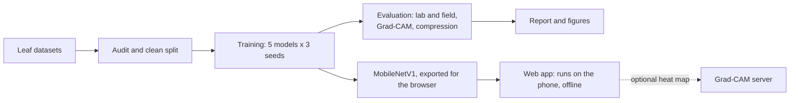

# Plant leaf disease detection: from lab accuracy to the field

This project takes our earlier paper, *Plant Leaf Disease Detection Using Traditional CNN and
MobileNet Architecture* (Usman & Ali, [`docs/paper.pdf`](docs/paper.pdf)), and asks whether its
results hold up. It reproduces the paper, finds and fixes a flaw in how the dataset is usually
split, compares five neural networks fairly, tests them on real field photos, looks at what
they pay attention to, shrinks them for phones, and puts the chosen model in a web app that
works offline.

The full write-up is [the report](docs/report.md).

## The question

Models trained on the PlantVillage leaf images, including ours, often report 95–99% accuracy.
These photos were taken in a lab: one leaf, on a plain background, under even light. Two
things decide whether such a number means anything for a farmer with a phone:

1. **Is the test set really unseen?** The dataset we used (the Kaggle *New Plant Diseases
   Dataset*) was made by flipping and rotating photos to create extra copies, then splitting
   the files at random. Copies of one photo can end up in both training and validation.
2. **Does accuracy carry over to real photos?** Field photos have soil, other leaves, shadows
   and different cameras.

## What was done

| Phase | Work |
|---|---|
| 1. Data audit | Traced every image to its original photo and physical leaf (file names, upstream leaf ids, file hashes and a rotation-proof image fingerprint), then built a new train/validation/test split that keeps all copies of a leaf together |
| 2. Reproduction | Rebuilt the paper's CNN and MobileNet and retrained them as described, writing down every setting the paper left out |
| 3. Experiments | Retrained the paper's CNN and four pretrained networks (MobileNetV1, V2, V3-Small, EfficientNetB0) on the clean split with three random seeds each; tested on 2,557 field photos (PlantDoc); explained predictions with Grad-CAM; tested the paper's design choices; measured size and speed after compression |
| 4. App | A web app that runs the model on the phone itself, works offline, and is honest about when it is unsure |
| 5. Documentation | Report, model card, dataset card |

## What we found

All numbers are averages over three training runs and come straight from the saved results.

1. **The usual split leaks.** 90.3% of the validation images in the standard 80/20 split are
   copies of, or other photos of the same leaf as, training images.
2. **On truly unseen lab photos the networks are still very accurate**: 98.3% for MobileNetV1
   and 99.2% for EfficientNetB0. The paper's CNN reaches 88.5%.
3. **On real field photos every model fails**: 7–18% accuracy, a drop of more than 80
   percentage points. The models are also confidently wrong, so their confidence cannot be
   used to tell when they are mistaken.
4. **The models do look at the leaf** in lab photos, according to Grad-CAM. Field failure is not
   simply a matter of the model reading the background.
5. **Two of the paper's choices did not help**: its image augmentation gave no benefit, and
   freezing the pretrained network cost 4.7 points.
6. **MobileNetV1 compresses well**: a 3.55 MB version runs in 1.4 ms on a laptop CPU and loses
   only 0.5 points. The same compression breaks EfficientNetB0 and MobileNetV3-Small.

| Model | Size (M parameters) | Unseen lab photos | Field photos |
|---|---|---|---|
| Paper CNN | 2.43 | 88.5% | 7.5% |
| **MobileNetV1** (used in the app) | 3.27 | 98.3% | 16.3% |
| MobileNetV2 | 2.31 | 97.5% | 15.0% |
| MobileNetV3-Small | 0.96 | 98.5% | 13.8% |
| EfficientNetB0 | 4.10 | 99.2% | 18.2% |

## What is Grad-CAM?

Grad-CAM (*Gradient-weighted Class Activation Mapping*) is a way to see which parts of an image
a network relied on for its answer. It takes the network's last layer of image features, asks
how much each feature map pushed the score of the predicted disease up, and adds the maps
together weighted by that amount. The result is a heat map laid over the photo: bright where
the image mattered for the decision, dark where it did not.

We used it to check whether the networks look at the diseased spots on the leaf or at the
background. On lab photos the pretrained networks focus on the leaf and its lesions, and still
classify correctly when the background is greyed out. On field photos their attention spreads
to soil, other leaves and watermarks.

## The app

The web app classifies a leaf photo into one of 38 classes (14 crops, healthy or diseased). The
model runs inside the browser, so photos stay on the phone, and the app keeps working without
internet once it has been opened. It answers "not a leaf" when the photo has too few plant
colours, says "not sure" when the model is unsure, always shows the three most likely classes,
and states that accuracy on field photos was about 16% in our tests. It also includes a
library of the 38 classes and a page with the research results. A small optional server can
draw a Grad-CAM heat map for a photo when the user asks for one.

## Repository

| Folder | Contents |
|---|---|
| `ml/` | Python code (TensorFlow/Keras): data audit and split, training, evaluation, Grad-CAM, compression, results of every run |
| `web/` | the web app (Next.js) |
| `api/` | the optional Grad-CAM server (FastAPI) |
| `docs/` | [report](docs/report.md), [model card](docs/model_card.md), [dataset card](docs/dataset_card.md), [reproduction notes](docs/reproduction.md), [experiments](docs/experiments.md), [how to rerun everything](docs/reproducing.md), [deployment](docs/deployment.md), figures |

## Data

Training images come from the New Plant Diseases Dataset, a re-release of PlantVillage
(CC BY-SA 3.0); field photos from PlantDoc (CC BY 4.0). The repository contains no dataset
images apart from small example figures, with attribution. See the
[dataset card](docs/dataset_card.md).

This is a research project, not agronomic advice.
