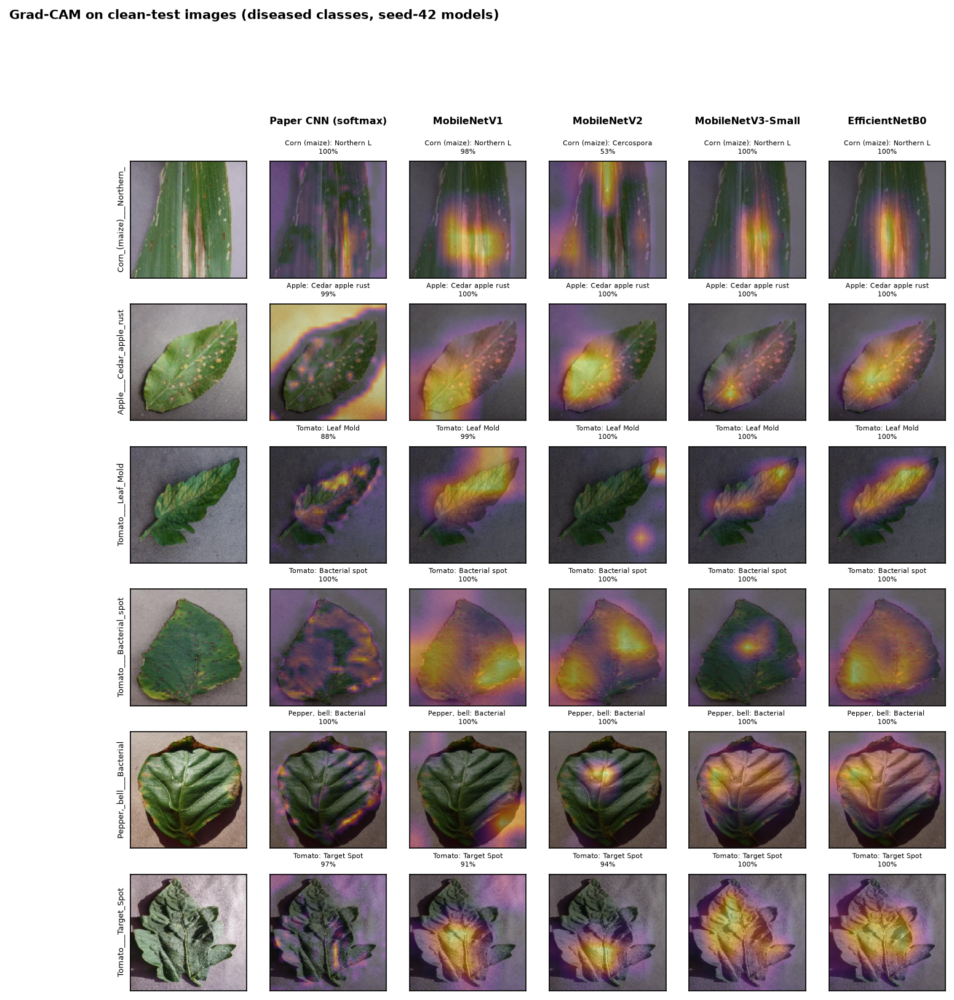
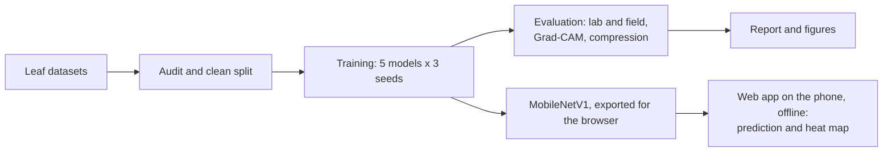

# Plant leaf disease detection: from lab accuracy to the field

A computer vision project that classifies plant leaf diseases from photos and asks a harder
question than "how accurate is it?": **does that accuracy hold for real photos taken in a
field?** It audits a popular dataset for leakage, trains and compares five neural networks
fairly, tests them on real field photos, explains what they look at, compresses them for
phones, and serves the chosen model in a web app that works offline.

The full write-up is [the report](docs/report.md).

## The question

Models trained on the PlantVillage leaf images often report 95–99% accuracy. These photos were
taken in a lab: one leaf, on a plain background, under even light. Two things decide whether
such a number means anything for a farmer with a phone:

1. **Is the test set really unseen?** The widely used Kaggle *New Plant Diseases Dataset* was
   made by flipping and rotating photos to create extra copies, then splitting the files at
   random. Copies of one photo can end up in both training and validation.
2. **Does accuracy carry over to real photos?** Field photos have soil, other leaves, shadows
   and different cameras.

## What was done

| Step | Work |
|---|---|
| 1. Data audit | Traced every image to its original photo and physical leaf (file names, upstream leaf ids, file hashes and a rotation-proof image fingerprint), then built a new train/validation/test split that keeps all copies of a leaf together |
| 2. Baselines | Trained a custom CNN and MobileNet on the standard split, as commonly done, to have a reference point |
| 3. Experiments | Trained a custom CNN and four pretrained networks (MobileNetV1, V2, V3-Small, EfficientNetB0) on the clean split with three random seeds each; tested on 2,557 field photos (PlantDoc); explained predictions with Grad-CAM; tested design choices (augmentation, frozen vs fine-tuned network, network width); measured size and speed after compression |
| 4. App | A web app that runs the model on the phone itself, works offline, and is honest about when it is unsure |
| 5. Documentation | Report, model card, dataset card |
| 6. Field accuracy | Split the field photos into train, validation and test sets (keeping copies of a photo together), compared methods with and without labelled field photos under a protocol fixed in advance, and deployed the best one in the app |

## What we found

All numbers are averages over three training runs and come straight from the saved results.

1. **The usual split leaks.** 90.3% of the validation images in the standard 80/20 split are
   copies of, or other photos of the same leaf as, training images.
2. **On truly unseen lab photos the networks are very accurate**: 98.3% for MobileNetV1 and
   99.2% for EfficientNetB0. A custom CNN trained from scratch reaches 88.5%.
3. **On real field photos every model fails**: 7–18% accuracy, a drop of more than 80
   percentage points. The models are also confidently wrong, so their confidence cannot be
   used to tell when they are mistaken.
4. **The models do look at the leaf** in lab photos, according to Grad-CAM. Field failure is not
   simply a matter of the model reading the background.
5. **Common training choices did not help**: the standard image augmentation gave no benefit,
   and freezing the pretrained network cost 4.7 points.
6. **MobileNetV1 compresses well**: a 3.55 MB version runs in 1.4 ms on a laptop CPU and loses
   only 0.5 points. The same compression breaks EfficientNetB0 and MobileNetV3-Small.
7. **Labelled field photos close much of the gap.** Fine-tuning MobileNetV1 on about 45 field
   photos per class, while mixing in lab photos so it does not forget them, raises accuracy on
   held-out field photos from 18% to 54%, at a cost of under 1 point on lab photos. Its
   confidence also becomes meaningful (calibration error from 60% to 7%). Methods that use no
   field labels gain only 2–4 points. Details in [docs/field.md](docs/field.md).

Trained on lab photos only (mean of 3 runs; field photos: all 2,557 PlantDoc images):

| Model | Size (M parameters) | Unseen lab photos | Field photos |
|---|---|---|---|
| Custom CNN | 2.43 | 88.5% | 7.5% |
| MobileNetV1 | 3.27 | 98.3% | 16.3% |
| MobileNetV2 | 2.31 | 97.5% | 15.0% |
| MobileNetV3-Small | 0.96 | 98.5% | 13.8% |
| EfficientNetB0 | 4.10 | 99.2% | 18.2% |
| **MobileNetV1 + field fine-tuning** (used in the app) | 3.27 | 97.8% | 54.3%* |

\* on the 898 held-out field-test photos, which were not used for training or for any choice.

## What is Grad-CAM?

Grad-CAM (*Gradient-weighted Class Activation Mapping*) is a way to see which parts of an image
a network relied on for its answer. It takes the network's last layer of image features, asks
how much each feature map pushed the score of the predicted disease up, and adds the maps
together weighted by that amount. The result is a heat map laid over the photo: bright where
the image mattered for the decision, dark where it did not.

We used it to check whether the networks look at the diseased spots on the leaf or at the
background. On lab photos the pretrained networks focus on the leaf and its lesions, and still
classify correctly when the background is greyed out. On field photos their attention spreads
to soil, other leaves and watermarks.

## The app

The web app classifies a leaf photo into one of 38 classes (14 crops, healthy or diseased). The
model runs inside the browser, so photos stay on the phone, and the app keeps working without
internet once it has been opened. It answers "not a leaf" when the photo has too few plant
colours, says "not sure" when the model is unsure, always shows the three most likely classes,
and states the measured accuracy on field photos (54% on held-out PlantDoc photos). It also includes a
library of the 38 classes and a page with the research results. On request it also draws a
Grad-CAM heat map of where the model looked, computed on the phone as well.

The heat map is computed without automatic differentiation: because the network ends in
average pooling and one dense layer, the Grad-CAM weights have a closed form that needs only
the last feature maps, the class probabilities and the dense layer's weights. On 100 test
images it matches TensorFlow's gradient-based Grad-CAM with a median correlation of 0.99997,
and the hottest region agrees on all 100.

## Tech stack

| Area | Tools |
|---|---|
| Machine learning | Python, TensorFlow / Keras, NumPy, pandas, scikit-learn, Kaggle GPUs |
| Compression | TensorFlow Lite (INT8, dynamic-range), TensorFlow.js |
| Web app | Next.js, TypeScript, Tailwind CSS, TensorFlow.js, progressive web app (offline) |
| Optional server | FastAPI |
| Quality | pytest, Vitest, Playwright, ruff, ESLint, GitHub Actions |

## Repository

| Folder | Contents |
|---|---|
| `ml/` | Python code: data audit and split, training, evaluation, Grad-CAM, compression, results of every run |
| `web/` | the web app (Next.js) |
| `api/` | an optional prediction and Grad-CAM server (FastAPI); the app does not need it |
| `docs/` | [report](docs/report.md), [model card](docs/model_card.md), [dataset card](docs/dataset_card.md), [experiments](docs/experiments.md), [how to rerun everything](docs/reproducing.md), [deployment](docs/deployment.md), figures |

## Data

Training images come from the New Plant Diseases Dataset, a re-release of PlantVillage
(CC BY-SA 3.0); field photos from PlantDoc (CC BY 4.0). The repository contains no dataset
images apart from small example figures, with attribution. See the
[dataset card](docs/dataset_card.md).

This is a research project, not agronomic advice.
