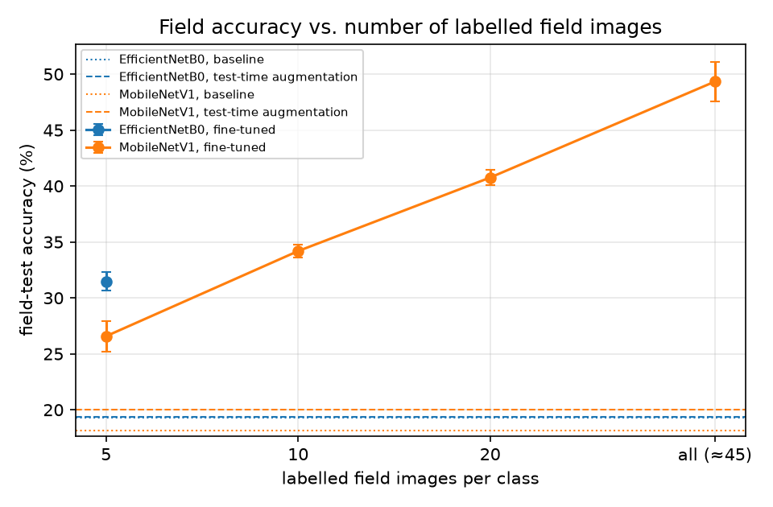

# Phase 6: improving accuracy on field photos

> **Status:** protocol fixed on 2026-11-18, before any Phase 6 experiment was run. Results
> (§6) are taken from the run outputs in `ml/results/p6_*/` by
> `python -m leafdx.field.report`. Any change to the protocol after that date is listed in §7.

## 1. Goal

Phase 3 showed that every model drops from 97–99% on leak-free lab images to 7–18% on PlantDoc
field photos. Phase 6 asks **how much of that gap can be closed, and at what cost in labelled
field photos**, while keeping lab accuracy and keeping a model small enough for the browser.

## 2. Data protocol

Until Phase 5, all 2,557 cleaned PlantDoc images were test data. Methods that learn from field
images need a separate, untouched test set, so the images are split once
(`python -m leafdx.data.field_split`; manifests in `ml/manifests/field_split/`, summary in
`figures/phase6/field_split.json`):

| Split | Images | Used for |
|---|---|---|
| field-train | 1,278 | labelled (or unlabelled) field examples a method may use |
| field-val | 381 | early stopping, hyper-parameter and method selection |
| field-test | 898 | reported once per final method; never used for any decision |

- **Grouped by near-duplicates.** PlantDoc was collected from the web and contains copies of
  the same picture. Images are linked when their rotation- and mirror-invariant pHash distance
  is at most 6 bits, and each group stays in one split. By inspection, pairs at 0–6 bits are
  mostly copies (resized, re-compressed, watermarked), and pairs at 8 bits or more mostly
  different photos. 85 pairs form 79 multi-image groups; 26 groups hold the same picture under
  different labels; PlantDoc's own train/test split cuts 9 groups in two.
- **Stratified by class**, 50/15/35, seed 42. *Tomato spider mites* has only 2 images (1 in
  field-train, 1 in field-test); its results are not interpretable.
- **Lab check set**: the same 746 leak-free clean-test images as the efficiency study (up to
  20 per class, seed 0), to detect forgetting of lab performance.
- Many PlantDoc images are stock photos on white backgrounds rather than photos taken in a
  field; "field" in this document means PlantDoc, with that caveat.

## 3. Starting models

Seed-42 Phase 3 models (`ml/models/p3_*`):
- **MobileNetV1**, the model deployed in the app;
- **EfficientNetB0**, the best Phase 3 model on PlantDoc.

All Phase 3 baselines are re-evaluated on **field-test** so before-and-after numbers use the
same images.

## 4. Methods

### Without field labels

| Id | Method | Field data used |
|---|---|---|
| B | Baseline: Phase 3 model as is | none |
| TTA | Test-time augmentation: average of 4 views (original, horizontal flip, 87.5% centre crop, its flip) | none |
| AdaBN | Re-estimate batch-normalisation statistics on field images (Li et al., 2016) | field-train images, **labels not used** |

### With field labels

| Id | Method | Field data used |
|---|---|---|
| FT-k | Fine-tune the whole network on *k* labelled field-train images per class (k = 5, 10, 20, all), mixed with a lab replay set of 20 images per class (to limit forgetting) | k labelled images per class |

Fixed settings for FT-k:
- Adam with learning rate 3e-5;
- batch 32;
- at most 15 epochs, early stopping on field-val loss with patience 3, best weights restored;
- batch-normalisation layers kept in inference mode;
- augmentation: random resized crop (60–100% area), horizontal and vertical flips, brightness,
  contrast and saturation jitter;
- 3 seeds (0, 1, 2), each drawing a different k-shot subset and lab replay set.

A smaller "all" learning-rate check (1e-4) is run on MobileNetV1 only and chosen on field-val.
The combination FT-all + TTA is evaluated if both help on field-val.

## 5. Metrics and decision rule

- **Primary:** field-test top-1 accuracy, with the 38-way output as in Phase 3.
- **Secondary:**
  - field-test macro-F1;
  - crop accuracy;
  - ECE (calibration error);
  - accuracy when the output is restricted to the 28 PlantDoc classes;
  - lab-check accuracy (forgetting).
- Mean ± std over seeds where a method has seeds.
- **The model to deploy is chosen on field-val**, among methods that keep lab-check accuracy
  within 2 pp of the baseline and stay MobileNetV1-sized. Its field-test number is then
  reported once.

## 6. Results

All numbers below are from `figures/phase6/results.md` (mean ± std over seeds), produced by
`python -m leafdx.field.report` from `ml/results/p6_*/`. Field-val is the selection set;
field-test numbers were not used for any decision.

### 6.1 MobileNetV1

| Method | Labelled field images / class | Field-val (%) | Field-test (%) | Field-test macro-F1 (%) | Field-test crop acc. (%) | Field-test ECE (%) | Lab check (%) |
|---|---|---|---|---|---|---|---|
| Baseline (Phase 3) | 0 | 14.96 | 18.15 | 16.62 | 39.76 | 59.73 | 99.06 |
| Test-time augmentation (TTA) | 0 | 17.06 | 20.04 | 18.88 | 41.31 | 51.06 | 99.20 |
| AdaBN | 0 (unlabelled) | 19.07 ± 0.40 | 19.78 ± 0.13 | 19.25 ± 0.12 | 43.76 ± 0.00 | 56.20 ± 0.16 | 93.16 ± 0.00 |
| Fine-tuning | 5 | 23.53 ± 1.71 | 26.58 ± 1.36 | 24.86 ± 0.89 | 48.48 ± 3.45 | 14.72 ± 1.63 | 98.53 ± 0.82 |
| Fine-tuning | 10 | 33.16 ± 1.71 | 34.19 ± 0.59 | 30.96 ± 0.74 | 56.94 ± 1.00 | 14.27 ± 2.26 | 97.94 ± 0.76 |
| Fine-tuning | 20 | 39.55 ± 2.26 | 40.76 ± 0.70 | 37.36 ± 0.86 | 62.47 ± 1.28 | 13.01 ± 0.40 | 98.17 ± 0.43 |
| Fine-tuning | all (≈45) | 48.38 ± 1.97 | 49.33 ± 1.78 | 43.25 ± 1.82 | 68.15 ± 1.93 | 9.24 ± 2.86 | 96.38 ± 0.48 |
| Fine-tuning, lr 1e-4 (1 seed) | all | 43.31 | 44.21 | 38.72 | 61.02 | 5.30 | 91.42 |
| Fine-tuning, 50 lab images/class replayed | all | 47.86 ± 2.12 | 50.00 ± 0.68 | 45.76 ± 1.22 | 69.34 ± 0.72 | 9.91 ± 0.85 | 97.94 ± 0.47 |
| **Fine-tuning, 50 replayed, + TTA** | all | **51.71 ± 2.59** | **53.08 ± 1.28** | **48.96 ± 1.04** | **72.16 ± 0.95** | **7.24 ± 0.21** | 98.26 ± 0.71 |

**Findings**

1. **Methods without field labels help little.** TTA and AdaBN add 2–4 points on field-val.
   AdaBN costs 6 points of lab accuracy (MobileNetV1) and up to 12 points (MobileNetV3-Small),
   because the field photos' batch statistics no longer match the lab photos'. The other
   models' rows are in `figures/phase6/results.md`.
2. **Labelled field photos help most, and steadily.** Field-test accuracy rises from 18% to
   27, 34, 41 and 49% with 5, 10, 20 and all (median 45) labelled photos per class, roughly
   linearly in the logarithm of the number of photos, with no sign of levelling off. More
   labelled field photos would very probably help further.
3. **Calibration is repaired.** The baseline's field confidence is far too high (ECE 60%);
   after fine-tuning it is 7–15%, so the app's "not sure" and "uncertain" verdicts become
   meaningful on field photos.
4. **Forgetting is small and controllable.** Mixing in 20 lab images per class keeps lab-check
   accuracy within 0.5–1.1 points for k ≤ 20, but loses 2.7 points with all field images. With 50
   lab images per class the loss is 1.1 points at the same field accuracy (field-val 47.9
   vs 48.4). A larger learning rate (1e-4) is worse on both field-val and lab-check.
5. **TTA adds on top of fine-tuning** (+3.9 points on field-val, +3.1 on field-test, lower ECE).

### 6.2 EfficientNetB0

Fine-tuning EfficientNetB0 (k = 5: 31.48 ± 0.82% field-test, lab check 99.55%) gains more
from 5 labelled photos per class than MobileNetV1 does. Its larger-k runs are in
`figures/phase6/results.md` once complete. EfficientNetB0 is a comparison only: the decision
rule keeps the deployed model MobileNetV1-sized.

### 6.3 Selection and the deployed model

- **Eligible methods** (lab check ≥ 97.06%, i.e. within 2 points of 99.06%): fine-tuning with
  k = 5, 10, 20, fine-tuning on all field-train images with 50 replayed lab images, and the same
  with TTA. Fine-tuning on all images with 20 replayed (96.38%) and the lr 1e-4 run (91.42%)
  are not eligible.
- **Chosen on field-val:** fine-tuning on all field-train images, 50 replayed lab images per
  class, + TTA (51.71% field-val). Of its three seeds, seed 0 has the highest field-val
  (54.59%) and is deployed (see §7, item 2).
- **Deployed model** (`figures/phase6/deployed.json`, `python -m leafdx.field.deploy --tta`):

| | Before (Phase 3, seed 42) | After (deployed) |
|---|---|---|
| Field-test accuracy (898 images) | 18.15% | **54.34%** |
| Field-test macro-F1 | | 48.70% |
| Field-test crop accuracy | | 73.16% |
| Field-test ECE | 59.73% | 7.01% |
| Lab, leak-free test (11,599 images) | 98.55% | 97.78% |
| Lab, leak-free test, ECE | | 1.20% |
| Size in the browser (TF.js, float16) | 6.6 MB | 6.55 MB |

Seed 0 was picked as the best of three on field-val, so its field-test score (54.34%) is a
little optimistic; the method's mean over seeds, 53.08 ± 1.28%, is the better estimate of what
to expect. Without TTA the same model scores 50.33% on field-test and 97.28% on the lab test.

**Per class** (`figures/phase6/per_class_deployed.md`): 22 of 28 classes improve, many from
under 20% to over 65% (e.g. *Corn: Northern Leaf Blight* 12 → 86%, *Tomato: Leaf Mold*
3 → 72%, *Apple: Healthy* 0 → 67%). Five get worse, all diseases that look like another
disease of the same crop: *Corn: Cercospora / Gray leaf spot* falls from 83% to 22% (15 of its
23 field-test photos are now called *Northern Leaf Blight*); *Tomato: Early blight*,
*Tomato: Late blight* and *Potato: Early blight* are confused with each other, with *Septoria
leaf spot* and with *Leaf Mold*; *Pepper: Bacterial spot* falls from 28% to 20%. *Tomato:
Spider mites* (1 image) stays at 0%. Most remaining errors stay
within the right crop (crop accuracy 73%).

**Browser check** (`figures/phase6/tfjs_verify*.json`, 100 images: 76 lab, 24 field-test):

- The TF.js model agrees with Keras on the top class for all 100 images; the largest
  probability difference is 0.012.
- The app's TTA (`web/src/lib/tta.ts`) agrees with the Python TTA on all 100 images; the
  largest difference is 0.008.
- In-browser Grad-CAM matches TensorFlow's gradient Grad-CAM with a median correlation of
  0.99998.
- One view takes 29 ms (median) with the WebAssembly backend in Node; TTA runs four views in
  one batch.

### 6.4 What this does and does not show

- **The gain is real but specific to PlantDoc.** The model was fine-tuned and tested on
  different photos from the same web-collected source. Photos taken by farmers with other
  phones, in other regions, would probably score lower. A new, independently collected field
  test set is the next step.
- **The field-test set is small** (898 images, 19–65 per class, one class with 1 image), so
  per-class numbers move by several points with each image.
- **Lab and field-test were each looked at once for the deployed model.** The deployed model's
  field-test number was not used to choose anything.

## 7. Deviations from this protocol

1. **Lab replay size (added 2026-11-18, after the learning-rate check and before the main
   sweep).** In the learning-rate check (MobileNetV1, FT-all, seed 0), lab-check accuracy fell
   by 2.55 pp, more than the 2 pp allowed by the decision rule. A variant with 50 instead of 20
   lab replay images per class is therefore added for MobileNetV1 FT-all (3 seeds), the
   candidate for deployment. Like every other choice, it is compared on field-val and lab-check
   only; field-test is not looked at for this decision.
2. **Choice of seed (added 2026-11-18, before the deployed model was evaluated).** §5 says
   which method to deploy but not which of its three trained models. The model with the highest
   field-val accuracy (seed 0) was deployed; its field-test score is therefore reported next to
   the method's mean over seeds (§6.3).
