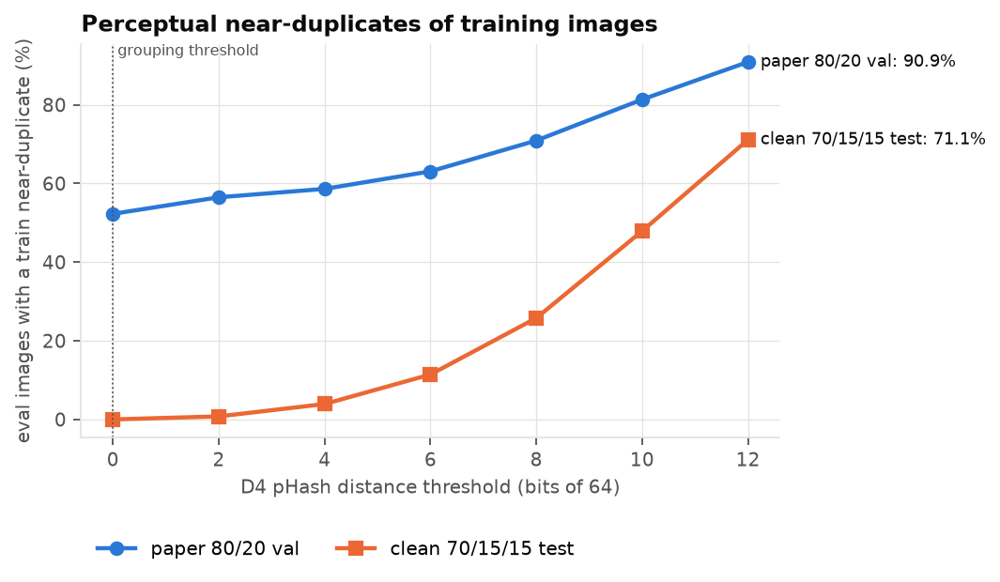
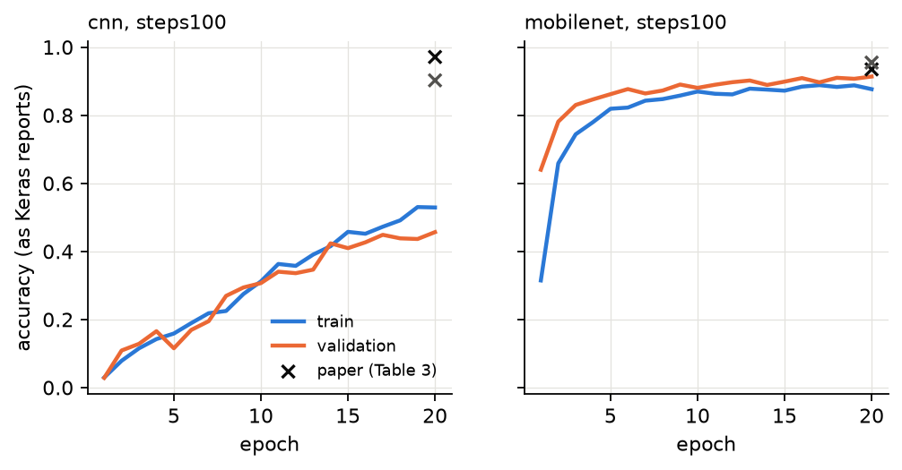
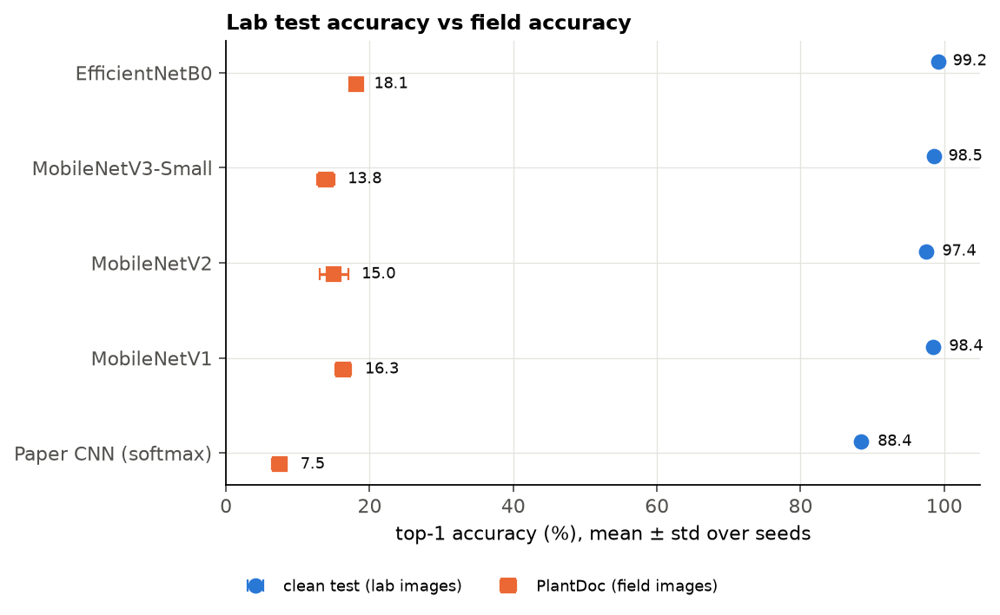
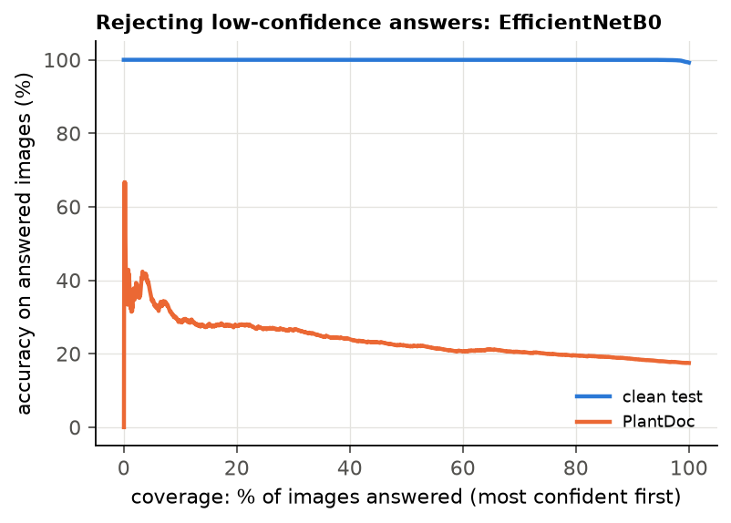
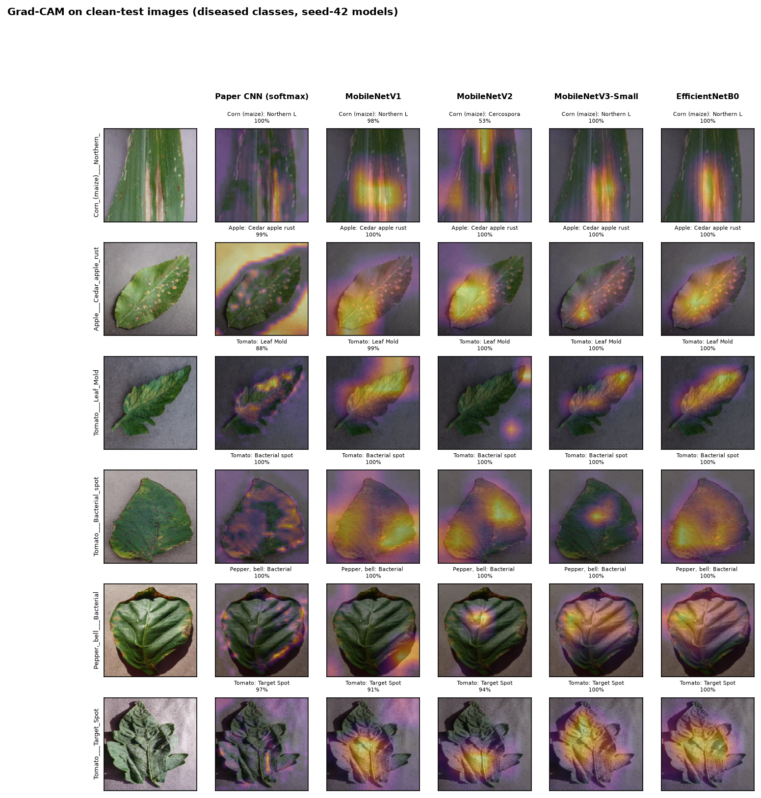
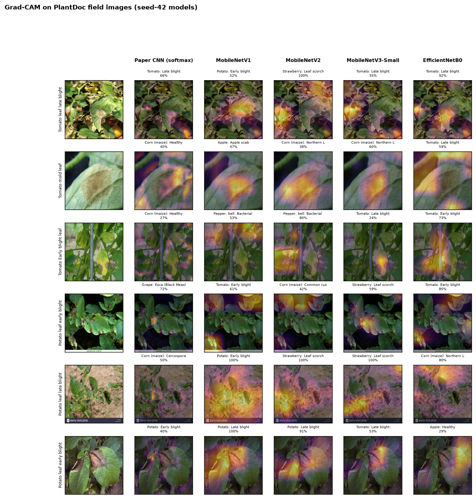

# Leakage, Field Shift and Deployment: Re-examining Plant Leaf Disease Classification with CNNs and MobileNets

**Syed Moazam Ali**

Technical report, November 2026. Code, data manifests, results and this report:
<https://github.com/MoazamAli45/plant-leaf-disease-detection>

> Every number in this report is produced by a script from a run's output files in
> `ml/results/` and `docs/figures/`. File paths are given next to each table. Results are
> mean ± standard deviation over three seeds (42, 43, 44) unless stated otherwise.

## Abstract

We revisit an earlier study of ours [`usman_ali_plant_leaf`] that classified 38 plant leaf
disease classes from the New Plant Diseases Dataset (NPD) [`npd_kaggle`], an offline-augmented
re-release of PlantVillage [`hughes2015open`]. In that study a custom CNN reached 90.25% and
MobileNet 95.47% validation accuracy. We first reproduce both models (MobileNet within 0.6 pp;
the CNN 5.7 pp lower). We then audit the dataset and find that **90.3% of the validation images
in the standard 80/20 split are augmented copies of, or other photos of the same leaf as,
training images**. We build a grouped 70/15/15 split and retrain five models (the paper's CNN
with a softmax output, MobileNetV1, MobileNetV2, MobileNetV3-Small and EfficientNetB0) with
three seeds each. Fine-tuned backbones reach 97.5–99.2% accuracy on leak-free test images.
Yet on PlantDoc [`singh2020plantdoc`], 2,557 field photographs covering 28 of the classes,
every model falls to 7–18%, a gap of 81–85 pp that a better lab score does not close. The
models are confidently wrong in the field, so a confidence threshold does not catch these
errors. Grad-CAM and counterfactual masking show that fine-tuned models do look at the leaf
on lab images. Ablations show that the paper's augmentation does not help, and that the
paper's frozen backbone costs 4.7 pp. Full INT8 quantisation is almost lossless for
MobileNetV1 (−0.54 pp, 3.55 MB, 1.4 ms on a laptop CPU) but breaks EfficientNetB0 and
MobileNetV3-Small. We deploy MobileNetV1 in an offline progressive web app that classifies
in the browser and tells users plainly that field accuracy is low.

## 1. Introduction

Image classifiers for plant disease regularly report accuracies above 95% on PlantVillage-
derived datasets [`mohanty2016using`]. Our earlier study [`usman_ali_plant_leaf`] is one of
them: a three-block CNN trained from scratch and an ImageNet-pretrained MobileNet
[`howard2017mobilenets`] reached 90.25% and 95.47% validation accuracy on NPD.

Two questions decide whether such numbers mean anything for a farmer with a phone:

1. **Is the validation set independent of the training set?** NPD was produced by augmenting
   PlantVillage photos offline (flips, rotations, colour changes) and then splitting the
   resulting files at random. Copies of one photo can therefore land on both sides of the
   split. This is a form of data leakage [`kaufman2012leakage`].
2. **Does lab accuracy transfer to field photos?** PlantVillage leaves were photographed one
   at a time on a uniform background. Mohanty et al. already observed accuracy dropping to
   31.4% on images collected online [`mohanty2016using`], and a model trained on 8 background
   pixels alone reaches 49% on PlantVillage [`noyan2022uncovering`].

This report answers both questions for our own models and goes further. Contributions:

- **A reproduction** of the original two models, with every unstated choice listed as a
  numbered assumption (§4.1, `docs/reproduction.md`).
- **A leakage audit of NPD** that links images by source-photo file names, upstream leaf
  identifiers, file hashes and a rotation- and mirror-invariant perceptual hash (§3).
- **A grouped split** and a three-seed comparison of five architectures, reported on
  leak-free test images and on field photos (§5.2–5.3).
- **An analysis of why field accuracy fails** (§5.3), **what the models look at** (§5.4),
  **ablations** of the original design choices (§5.5), and **on-device efficiency** after
  quantisation (§5.6).
- **An offline web application** that runs the selected model in the browser and
  communicates its limits honestly (§6).

## 2. Related work

**PlantVillage and its derivatives.** Hughes and Salathé released the PlantVillage images
[`hughes2015open`]. Mohanty et al. trained AlexNet and GoogLeNet on 54,306 of them and reached
99.35% on held-out data, but 31.4% on images taken under other conditions
[`mohanty2016using`]. NPD [`npd_kaggle`] re-released the data with offline augmentation and a
fixed 80/20 split; it is widely used through Kaggle.

**Dataset bias.** Noyan showed that PlantVillage carries capture bias: 8 background pixels
predict the class with 49% accuracy against 2.6% chance [`noyan2022uncovering`]. PlantDoc
[`singh2020plantdoc`] was collected from the web to provide field images with the same
crop and disease names.

**Leakage.** Kaufman et al. define leakage as information in the training data that would not
be available at prediction time, and recommend a strict separation between learning and
evaluation data [`kaufman2012leakage`]. Augmented copies or repeat photos of one leaf shared
between training and evaluation sets are an instance of this.

**Models and tools.** We use MobileNetV1 [`howard2017mobilenets`], MobileNetV2
[`sandler2018mobilenetv2`], MobileNetV3-Small [`howard2019mobilenetv3`] and EfficientNetB0
[`tan2019efficientnet`]; Grad-CAM [`selvaraju2017gradcam`] for explanations; expected
calibration error [`guo2017calibration`]; integer quantisation [`jacob2018quantization`]; and
the DCT perceptual hash [`zauner2010phash`].

## 3. Data and leakage audit

Details: `docs/dataset_card.md`; numbers from `docs/figures/data_audit/summary.json` and
`recheck_newpixel.json`.

**Datasets.** NPD version 2 has 87,867 images (70,295 train, 17,572 validation) in 38 classes
of 14 crops. Of these, 48,239 are original photos and the rest are offline-augmented copies.
PlantDoc has 2,578 field images; 2,557 remain after removing byte-identical files with
conflicting labels and same-label duplicates, covering 28 of the 38 NPD classes through a
hand-written class mapping (`ml/resources/`).

**Linking images.** Two images are linked when any of the following holds:

- **same source photo:** NPD's file names encode the augmentation applied to an original
  (e.g. `_flipLR`, `_180deg`, `_new30degFlipLR`), so copies can be traced to their source;
- **same physical leaf:** PlantVillage's upstream `leaf-map.json` assigns leaf identifiers
  (7,378 leaves cover 69.2% of NPD's images);
- **identical file:** SHA-256;
- **perceptual near-duplicate:** a 64-bit DCT pHash made invariant to the 8 rotations and
  mirrorings of the square, compared within each class. Only exact matches (0 bits) are used
  for grouping. At 2 bits and above pHash also matches different leaves on the same lab
  background.

**Leakage in the standard split.** 90.31% of the validation images (15,869 of 17,572) are
linked to a training image. The first audit reported 87.5%; a file-name pattern
(`_newPixel25`, 2,399 images) was missed then and is counted now. This is a lower bound,
because photos of the same leaf without a leaf identifier are linked only if pHash matches
exactly.

**Grouped split.** Connected components of the link graph form groups (22,133 groups, largest
110 images), which are assigned whole to train, validation or test in a split stratified by
class: 61,485 / 13,185 / 13,171 images. The same missed file-name pattern leaves 11.94% of
test images linked to training images, concentrated in a few classes (98.2% of *Raspberry
healthy*, 93.8% of *Peach healthy*). We therefore report test accuracy on all test images and
on the **leak-free subset** of 11,599 images with no link. The two differ by at most 0.15 pp
for every model (§5.2). A corrected split (v2) can be generated from the fixed parser.

## 4. Methods

### 4.1 Reproduction (Phase 2)

The original paper specifies the architectures, input size (224 × 224), the augmentation
types, 20 epochs and the final metrics, but not the optimiser, learning rate, batch size,
augmentation magnitudes, loss for the sigmoid CNN, or whether the MobileNet backbone was
frozen. We record nine assumptions (A1–A9 in `docs/reproduction.md`). The most consequential:
categorical cross-entropy for both models (A1; binary cross-entropy cannot produce the paper's
loss curve), Adam with learning rate 1e-3 and batch 32 (A4), and a frozen MobileNet backbone
with only the 38,950-parameter head trained (A6). The paper's description of the schedule
admits two readings (100 steps per epoch, or full passes); both were run (A8). Models are
trained on the paper's 80/20 split and evaluated on its validation set, as in the paper.

### 4.2 Corrected and extended experiments (Phase 3)

Changes relative to the reproduction (`docs/experiments.md` §1):

- **Data:** the grouped split; results on the held-out test set and on PlantDoc.
- **CNN head:** softmax instead of sigmoid.
- **Backbones:** MobileNetV1 (α = 1.0), MobileNetV2, MobileNetV3-Small and EfficientNetB0,
  ImageNet-pretrained and **fine-tuned end to end**, each with its own ImageNet preprocessing
  and a head of global average pooling, dropout 0.2 and a 38-way softmax.
- **Augmentation:** the reproduction's transforms and magnitudes, implemented as Keras layers
  run on the GPU.
- **Training:** Adam (1e-3 for the CNN, 1e-4 for fine-tuning), batch 32, up to 20 epochs
  with early stopping on validation loss (patience 5, best weights restored), mixed float16,
  three seeds. Kaggle, 2 × Tesla T4, TensorFlow 2.21.
- **Metrics:** accuracy, macro-F1, per-class precision/recall/F1, confusion matrices, expected
  calibration error (ECE, 15 bins) [`guo2017calibration`], and accuracy versus coverage when
  predictions below a confidence threshold are withheld.
- **PlantDoc** is evaluated on all 28 mapped classes, with a 38-way output (the model may
  predict a class absent from PlantDoc), and on the subset of classes whose mapping is exact.
- **Ablations** of MobileNetV1, three seeds each: no augmentation; frozen backbone (the
  original set-up); width multipliers 0.75 and 0.5. Differences from the main model are
  tested with Welch's t-test over seeds.

### 4.3 Explainability

For seed-42 models we compute Grad-CAM [`selvaraju2017gradcam`] at the last convolutional
layer on 185 clean-test originals (5 per class, where an upstream leaf segmentation exists).
Using the PlantVillage authors' segmentation masks we measure (i) the **leaf ratio**, the
share of Grad-CAM mass that falls on the leaf divided by the share of the image that is leaf
(1 means no preference), and (ii)
accuracy when the image is reduced to **the leaf only** (background grey), **the background
only** (dilated leaf mask grey), or **a 16-pixel border strip only**.

### 4.4 Efficiency

Seed-42 models are converted to TensorFlow Lite as float32, dynamic-range (int8 weights) and
full INT8 (int8 weights and activations, calibrated on 200 training images), and to
TensorFlow.js. We measure file size, median CPU latency (Apple M3 Pro, batch 1, 4 threads,
50 runs after 10 warm-ups), accuracy on 746 leak-free test images (up to 20 per class) and
agreement with the original Keras model.

## 5. Results

### 5.1 Reproduction

Source: `docs/figures/reproduction/paper_vs_reproduced.md` (seed 42, full-epoch schedule,
paper's validation split).

| Model | Metric | Paper | Reproduced | Difference |
|---|---|---|---|---|
| CNN (sigmoid) | train accuracy | 97.11 | 92.49 | −4.62 pp |
| | validation accuracy | 90.25 | 84.58 | −5.67 pp |
| | validation loss | 0.3605 | 0.5527 | +0.1922 |
| MobileNet (frozen) | train accuracy | 93.48 | 92.15 | −1.33 pp |
| | validation accuracy | 95.47 | 94.88 | −0.59 pp |
| | validation loss | 0.1419 | 0.1537 | +0.0118 |
| | validation macro-F1 | 95.00 | 94.89 | |

MobileNet is reproduced within 1.4 pp on every reported number. The CNN is reproduced only
partly. The most likely cause is stronger augmentation in our assumptions than in the
original, since our model fits the training data less tightly; single-run variation is
another (validation accuracy moved by up to 4.4 pp between epochs). The 100-step reading of
the schedule fits the paper's curves far worse (validation accuracy 45.67% for the CNN) and
is kept as a documented negative result.

### 5.2 Clean split

Source: `docs/figures/phase3/main_results.md`.

| Model | Params (M) | Test acc. (%) | Test acc., leak-free (%) | Test macro-F1 (%) | Test ECE (%) |
|---|---|---|---|---|---|
| Paper CNN (softmax) | 2.43 | 88.40 ± 0.45 | 88.46 ± 0.38 | 88.39 ± 0.41 | 2.84 ± 0.20 |
| MobileNetV1 | 3.27 | 98.40 ± 0.38 | 98.26 ± 0.43 | 98.39 ± 0.38 | 0.60 ± 0.24 |
| MobileNetV2 | 2.31 | 97.43 ± 0.40 | 97.47 ± 0.43 | 97.40 ± 0.38 | 1.16 ± 0.31 |
| MobileNetV3-Small | 0.96 | 98.52 ± 0.17 | 98.45 ± 0.18 | 98.50 ± 0.17 | 0.55 ± 0.12 |
| EfficientNetB0 | 4.10 | **99.22 ± 0.09** | **99.18 ± 0.07** | **99.21 ± 0.08** | **0.32 ± 0.03** |

On held-out lab images, fine-tuned backbones reach 97.5–99.2% and are well calibrated; the
from-scratch CNN reaches 88.5%. MobileNetV3-Small matches MobileNetV1 with 3.4× fewer
parameters. Leak-free and full test accuracy agree within 0.15 pp.

**How much did leakage inflate the original numbers?** The fairest comparison is the
frozen-backbone ablation (§5.5), which matches the original MobileNet set-up apart from the
preprocessing: 93.58 ± 0.31% on the leak-free test set, against 94.88% for the reproduction
on the leaky validation set. The difference is small, about 1.3 pp, and the preprocessing
differs, so we do not claim an exact figure. Leakage is a serious flaw in the protocol, but
on this lab benchmark it is not what makes the accuracies misleading. The field shift is.

### 5.3 Field images (PlantDoc)

| Model | PlantDoc acc. (%) | PlantDoc macro-F1 (%) | Exact-match classes acc. (%) | PlantDoc ECE (%) | Lab − field gap (pp) |
|---|---|---|---|---|---|
| Paper CNN (softmax) | 7.46 ± 1.02 | 6.72 ± 1.23 | 9.28 ± 1.64 | 68.24 ± 1.59 | 81.01 ± 0.87 |
| MobileNetV1 | 16.33 ± 1.12 | 15.60 ± 0.96 | 22.23 ± 1.58 | 62.18 ± 2.25 | 81.93 ± 0.77 |
| MobileNetV2 | 15.02 ± 1.98 | 13.75 ± 1.11 | 19.06 ± 2.58 | 62.72 ± 4.07 | 82.46 ± 2.23 |
| MobileNetV3-Small | 13.84 ± 1.22 | 13.49 ± 1.02 | 15.30 ± 1.74 | 60.42 ± 2.82 | 84.60 ± 1.04 |
| EfficientNetB0 | **18.15 ± 0.58** | **17.76 ± 0.32** | 22.23 ± 1.37 | 57.43 ± 3.08 | 81.03 ± 0.60 |

Chance is 2.6%. **Every model loses 81–85 pp** between leak-free lab images and field images.
The ranking on lab images roughly carries over, but the gap does not shrink: EfficientNetB0
is best in both places and still answers 82% of field images wrongly.

**Why it fails** (`docs/figures/phase3/field_analysis.md`):

| Model | Correct crop (%) | Healthy vs diseased (%) | Predictions on 4 most-predicted classes (%) | Predictions on classes absent from PlantDoc (%) | Mean confidence, correct / wrong (%) |
|---|---|---|---|---|---|
| Paper CNN | 23.90 | 72.27 | 38.52 | 34.57 | 79.9 / 75.4 |
| MobileNetV1 | 37.48 | 76.50 | 43.23 | 26.09 | 86.0 / 77.1 |
| MobileNetV2 | 32.24 | 72.44 | 41.75 | 21.84 | 84.2 / 76.6 |
| MobileNetV3-Small | 32.79 | 75.27 | 44.31 | 33.10 | 82.4 / 72.9 |
| EfficientNetB0 | 38.74 | 71.88 | 43.49 | 24.66 | 83.6 / 73.7 |

1. **The crop itself is mostly wrong**: the best model names the right species for 39% of
   field images. Telling healthy from diseased (72–77%) barely beats always answering
   "diseased" (66.8%).
2. **Predictions collapse** onto a few classes: 39–44% of field predictions fall on four
   classes, and 22–35% on diseases that PlantDoc does not contain.
3. **The models are confidently wrong.** Wrong field answers average 73–77% confidence; ECE
   rises from at most 2.8% on lab images to 57–68%.
4. **Withholding low-confidence answers does not help.** At a 0.9 threshold EfficientNetB0
   still answers 44.9% of field images, and 23.2% of those answers are right. On lab images
   the same threshold keeps 98.4% of images at 99.8% accuracy
   (`selective_prediction.md`).

### 5.4 What the models look at

Source: `docs/figures/phase3/explain/summary.json` (seed 42, 185 images, chance 2.6%).

| Model | Accuracy (%) | Grad-CAM leaf ratio (median) | Leaf only (%) | Background only (%) | Border strip only (%) |
|---|---|---|---|---|---|
| Paper CNN | 85.9 | 1.07 | 51.4 | 13.0 | 14.6 |
| MobileNetV1 | 97.3 | 1.46 | 89.2 | 7.6 | 6.5 |
| MobileNetV2 | 97.8 | 1.60 | 87.0 | 4.9 | 5.9 |
| MobileNetV3-Small | 98.9 | 1.75 | 81.1 | 7.0 | 10.3 |
| EfficientNetB0 | 98.9 | 1.82 | 71.9 | 8.1 | 11.9 |

Fine-tuned backbones concentrate Grad-CAM on the leaf (ratios 1.46–1.82) and on lesions in
the examples, and keep 72–89% accuracy when the background is removed. The paper's CNN barely
prefers the leaf (1.07). From the background or a border strip alone the models score 5–15%,
2–6× chance: a background cue exists but is weak for models trained on whole images (Noyan's
49% [`noyan2022uncovering`] is for a model *trained* on background pixels, so the numbers
measure different things). On field images, attention spreads to soil, neighbouring leaves
and watermarks.

So the models do learn leaf features on lab images, and still fail in the field. Lab-only
explanations are therefore not evidence of field reliability.

### 5.5 Ablations (MobileNetV1)

Source: `docs/figures/phase3/ablations.md`, `ablations_welch.md`.

| Variant | Params (M) | Test acc., leak-free (%) | PlantDoc acc. (%) | Lab Δ vs main (pp), p | Field Δ vs main (pp), p |
|---|---|---|---|---|---|
| main (fine-tuned, augmentation, α = 1.0) | 3.27 | 98.26 ± 0.43 | 16.33 ± 1.12 | | |
| no augmentation | 3.27 | 99.30 ± 0.09 | 16.18 ± 2.87 | +1.04, p = 0.048 | −0.16, p = 0.94 |
| frozen backbone (original set-up) | 3.27 | 93.58 ± 0.31 | 17.48 ± 0.64 | −4.68, p = 0.0002 | +1.15, p = 0.22 |
| width 0.75 | 1.86 | 98.61 ± 0.17 | 14.38 ± 0.87 | +0.35, p = 0.29 | −1.96, p = 0.08 |
| width 0.5 | 0.85 | 98.14 ± 0.18 | 14.44 ± 1.31 | −0.12, p = 0.69 | −1.89, p = 0.13 |

With three seeds per arm and eight comparisons, only the two lab effects with p < 0.05 are
treated as findings.

- **Freezing the backbone costs 4.7 pp** on lab images. Its field accuracy is not
  significantly different.
- **The original augmentation does not help**: lab accuracy is 1.0 pp higher without it
  (borderline), and field accuracy is unchanged. Flips, rotations and brightness changes do
  not simulate the shift from lab to field photographs.
- **Narrower networks keep lab accuracy** with 1.8× and 3.8× fewer parameters; whether they
  lose about 2 pp in the field cannot be settled with three seeds.

### 5.6 Efficiency

Source: `docs/figures/phase3/efficiency.md` (seed 42; selected rows).

| Model | Format | Size (MB) | CPU latency (ms) | Accuracy (%) | Agreement with Keras (%) |
|---|---|---|---|---|---|
| Paper CNN | TFLite INT8 | 2.45 | 0.57 | 87.80 | 98.66 |
| MobileNetV1 | Keras float32 | 13.40 | 7.34 | 99.06 | 100 |
| | TFLite INT8 | 3.55 | 1.39 | 98.53 | 99.20 |
| MobileNetV1, width 0.5 | TFLite INT8 | 1.00 | 0.66 | 98.12 | 99.46 |
| MobileNetV2 | TFLite INT8 | 2.76 | 1.33 | 95.58 | 97.05 |
| MobileNetV3-Small | TFLite dynamic-range | 1.13 | 1.25 | 99.20 | 99.20 |
| | TFLite INT8 | 1.24 | 0.90 | 60.86 | 60.72 |
| EfficientNetB0 | TFLite dynamic-range | 4.60 | 7.00 | 99.46 | 99.60 |
| | TFLite INT8 | 4.96 | 2.19 | 69.84 | 69.97 |

Full INT8 post-training quantisation [`jacob2018quantization`] is almost lossless for the
MobileNetV1 family (−0.54 pp at 3.8× smaller and 5.3× faster; 1.00 MB at width 0.5) but
breaks EfficientNetB0 (−29.8 pp) and MobileNetV3-Small (−38.1 pp), whose squeeze-and-
excitation blocks and swish-type activations are sensitive to activation quantisation.
Weight-only quantisation keeps both above 99%. Quantisation-aware training was not tried.

## 6. Deployment

MobileNetV1 is deployed although EfficientNetB0 is more accurate and MobileNetV3-Small is
smaller: it is the original paper's model, it quantises cleanly, and it is better than
MobileNetV3-Small on field images (16.33% vs 13.84%), which is where an app is used.

The application (`web/`) is a Next.js progressive web app. The model runs in the browser
with TensorFlow.js (WebGL, then WebAssembly, then CPU), so photos never leave the device and
the app works offline after the first visit. The TF.js model uses float16 weights (6.6 MB).
On 100 verification images it agrees with the Keras model on every prediction, whereas
uint8 weight quantisation agreed on only 87% and was rejected (`tfjs_verify_mnv1_*.json`).

Because §5.3 shows that confidence does not identify field errors, the app does not present
the model as a diagnosis tool. It answers "not a leaf" when too few pixels have plant colours,
"not sure" below 40% confidence and "uncertain" below 70%, shows the top three classes, and
states on every result that accuracy on field photos was 16% in our tests. An optional API
(`api/`, FastAPI) returns Grad-CAM overlays; it is called only when a user asks for one.

## 7. Limitations

- **Residual leakage in split v1** (§3) makes per-class test scores unreliable for five
  classes; aggregate results are reported on the leak-free subset.
- **PlantDoc is small and noisy**: 2,557 images, some with watermarks, collages or likely
  wrong labels, and only 28 of 38 classes. Its absolute numbers are uncertain, but an 81-pp
  gap is far larger than this noise.
- **Three seeds** give little statistical power for differences of 1–2 pp.
- **The reproduction rests on assumptions** about unreported settings (A1–A9).
- **No field training data was used.** The study measures the gap; it does not try to close
  it (e.g. with PlantDoc fine-tuning, background randomisation or segmentation).
- **Latency** was measured on a laptop CPU, not on a phone.

## 8. Conclusion

Re-examined with a grouped split, the original models' lab accuracy holds up and improves
with fine-tuning: 98.3% for MobileNetV1 and 99.2% for EfficientNetB0 on leak-free test
images. Leakage in the standard NPD split is extensive (90.3% of validation images) but
inflates lab accuracy only modestly. The decisive problem is the field: every model, from a
2.4 M-parameter CNN to EfficientNetB0, loses more than 80 pp on PlantDoc, and does so with
high confidence. Better architectures, more augmentation of the kind used here, or
explanations computed on lab images do not reveal or fix this. Work on PlantVillage-derived
data should report a field benchmark next to lab accuracy, and applications built on it
should say what that benchmark shows.

## Reproducibility

All code, configuration files, data manifests with SHA-256 checksums, per-run outputs and
the scripts that generate every table and figure are in the repository. Commands are in the
root `README.md`; training runs on free Kaggle GPUs through `ml/notebooks/kaggle_phase3.ipynb`.

## References

Keys refer to `docs/references.bib`.

- [`usman_ali_plant_leaf`] A. Usman and S. M. Ali. *Plant Leaf Disease Detection Using
  Traditional CNN and MobileNet Architecture.* Unpublished manuscript, UET Taxila.
- [`hughes2015open`] D. P. Hughes and M. Salathé. An open access repository of images on plant
  health to enable the development of mobile disease diagnostics. arXiv:1511.08060, 2015.
- [`mohanty2016using`] S. P. Mohanty, D. P. Hughes and M. Salathé. Using deep learning for
  image-based plant disease detection. *Frontiers in Plant Science* 7:1419, 2016.
- [`npd_kaggle`] New Plant Diseases Dataset, version 2. Kaggle, 2018.
- [`singh2020plantdoc`] D. Singh, N. Jain, P. Jain, P. Kayal, S. Kumawat and N. Batra.
  PlantDoc: A dataset for visual plant disease detection. *CoDS-COMAD*, pp. 249–253, 2020.
- [`noyan2022uncovering`] M. A. Noyan. Uncovering bias in the PlantVillage dataset.
  arXiv:2206.04374, 2022.
- [`kaufman2012leakage`] S. Kaufman, S. Rosset, C. Perlich and O. Stitelman. Leakage in data
  mining: Formulation, detection, and avoidance. *ACM TKDD* 6(4):15, 2012.
- [`zauner2010phash`] C. Zauner. Implementation and benchmarking of perceptual image hash
  functions. Master's thesis, Upper Austria University of Applied Sciences, 2010.
- [`howard2017mobilenets`] A. G. Howard et al. MobileNets: Efficient convolutional neural
  networks for mobile vision applications. arXiv:1704.04861, 2017.
- [`sandler2018mobilenetv2`] M. Sandler, A. Howard, M. Zhu, A. Zhmoginov and L.-C. Chen.
  MobileNetV2: Inverted residuals and linear bottlenecks. *CVPR*, pp. 4510–4520, 2018.
- [`howard2019mobilenetv3`] A. Howard et al. Searching for MobileNetV3. *ICCV*,
  pp. 1314–1324, 2019.
- [`tan2019efficientnet`] M. Tan and Q. V. Le. EfficientNet: Rethinking model scaling for
  convolutional neural networks. *ICML*, PMLR 97:6105–6114, 2019.
- [`selvaraju2017gradcam`] R. R. Selvaraju, M. Cogswell, A. Das, R. Vedantam, D. Parikh and
  D. Batra. Grad-CAM: Visual explanations from deep networks via gradient-based
  localization. *ICCV*, 2017.
- [`guo2017calibration`] C. Guo, G. Pleiss, Y. Sun and K. Q. Weinberger. On calibration of
  modern neural networks. *ICML*, PMLR 70:1321–1330, 2017.
- [`jacob2018quantization`] B. Jacob et al. Quantization and training of neural networks for
  efficient integer-arithmetic-only inference. *CVPR*, pp. 2704–2713, 2018.
